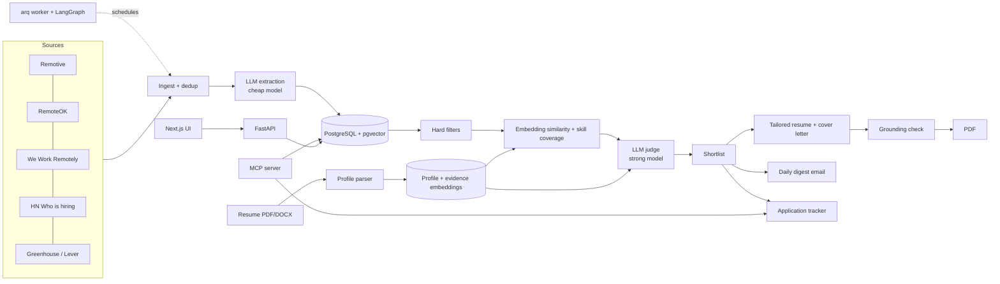

# JobHunt Copilot

An AI assistant for remote job hunting. Give it your resume once; every day it pulls new remote jobs from public job boards, works out which ones you are eligible for and a good fit for, explains why, and tailors your resume and cover letter using only facts from your real experience. It also tracks every application and reminds you to follow up.

> Status: under construction, milestone 5 of 10. Sections below are filled in as milestones land.


## Why it exists

I built this for my own remote job search. It is also a working example of production-minded LLM engineering: retrieval over your own experience, LangGraph workflows, structured extraction, hybrid ranking with an LLM judge, a grounding check that blocks unsupported claims, and evals with real numbers.

## Architecture



## Quickstart

```bash
git clone https://github.com/irfan-murtaza/jobhunt-copilot && cd jobhunt-copilot
cp .env.example .env            # add ANTHROPIC_API_KEY or OPENAI_API_KEY, and OPENAI_API_KEY for embeddings
docker compose up --build       # Postgres + pgvector, Redis, API, worker, web
open http://localhost:3000
```

Local development without Docker: `make setup`, then `make api`, `make worker` and `make web` in separate terminals (expects Postgres with pgvector and Redis on their default ports).

## Repository layout

```
api/   FastAPI service, arq worker, LangGraph workflows, MCP server, evals (Python 3.12, uv)
web/   Next.js App Router front end (TypeScript, Tailwind v4, dnd-kit)
docs/  Architecture notes and deployment guide
```

## Design decisions

Filled in per milestone. So far:

- **Jobs are shared, judgements are per user.** Ingestion and extraction run once per posting; filters, scores and the LLM judgement are stored per `(user, job)`. This keeps LLM spend linear in users who care about a job, not in users times jobs.
- **The edited profile is the source of truth; evidence is derived.** The profile document is JSON the user edits. Each bullet, project and skill is re-extracted into an `evidence` row with an embedding and a path back into the document, so retrieval and the grounding check cite exact facts.
- **One provider interface, native SDKs behind it.** Anthropic and OpenAI are both supported through one small `LLMProvider` protocol using each vendor's structured-output API. Model routing is three settings: a cheap model for extraction, a strong one for judging and writing.
- **Resume parsing copies, it does not summarise.** The extraction prompt forbids paraphrasing, added metrics or inferred skills, and the profile schema rejects unknown fields and malformed dates. Whatever the model returns is a draft the user reviews and edits; the edited version is what everything downstream uses.
- **File types come from magic bytes, not names.** Uploads are accepted as PDF or DOCX only after sniffing the header, capped at 5 MB, and a scanned or corrupt PDF returns a clear 422 instead of a crash.
- **Sources are adapters, the pipeline is one function.** Each board (Remotive, RemoteOK, We Work Remotely, Hacker News via Algolia, Greenhouse, Lever) is a small class that turns one public API into `RawJob`s and nothing else. Ingestion normalises, upserts by `(source, source_id)` and uses a content hash to tell "seen before" from "changed". A failing source is logged and skipped; the others continue.
- **Politeness is enforced in Redis, not by hope.** Every upstream response is cached for the source's TTL, ETag and Last-Modified are replayed as conditional requests, and a per-source cooldown key stops any worker process from hitting the same board twice in a row. The User-Agent names the project and links here.
- **Dedup is two-stage.** At ingest: same canonical URL, same content hash, or same normalised company and title within a month. After extraction: same company and embedding cosine similarity above 0.95. Every job points at the first copy seen; duplicates stay in the database for provenance but are hidden from the feed by default.
- **Pasted URLs are fetched with an SSRF guard.** Only public http(s) hosts that resolve to global addresses, capped at 2 MB, HTML only.
- **Three scoring stages, each cheaper than the next is expensive.** Hard filters are deterministic and give a reason for every exclusion (country, region or timezone eligibility from a geography table, remote type, seniority, salary floor, keywords). The hybrid score blends the mean cosine similarity of the top-3 retrieved evidence items with must-have skill coverage, 50/50. Only the top K jobs by hybrid score (K is a user preference, default 30) go to the LLM judge. Pure embeddings cannot tell "mentions Kafka" from "requires Kafka"; a judge on every job would cost dollars a day.
- **The judge can only cite evidence we gave it.** Retrieved evidence is labelled E1..En in the prompt. Strengths must reference a label and quote the text; a citation to an unknown label is dropped and counted in `dropped_citations`. The verdict is traceable to real resume facts before any document is written.
- **Scores are keyed by profile version.** Editing the profile invalidates every judgement; a re-run only redoes work for the current version.
- **The UI shows the reasoning, not just the rank.** Each match opens a three-step panel: which hard filters it passed or failed and why, which of your bullets were retrieved with their similarity, which must-have skills matched or are missing, and the judge's verdict with quoted evidence, gaps and risks. Scores you cannot interrogate are not worth trusting.
- **The tracker is an event log wearing a Kanban.** Stage changes, notes and reminders are append-only events, so every card has a full history. Moving to Applied stamps the date and schedules a follow-up seven days out; Offer and Rejected clear it.
- **Keyless development works.** `EMBEDDING_PROVIDER=hash` swaps in a deterministic offline embedder so the whole app runs without API keys, and provider misconfiguration surfaces as a 503 with a plain message instead of a 500.
- **Costs are measured, never guessed.** Every call records tokens and latency; cost is computed from a price table that returns `None` for unknown models rather than a made-up figure.

## Evaluation

Not run yet. Results will appear here as a table generated by `make evals`, never typed in by hand.

## What I'd do next

Filled in at milestone 10.

## License

MIT
