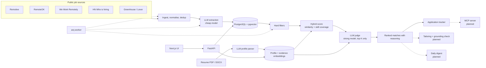

# JobHunt Copilot

[](https://github.com/irfan-murtaza/jobhunt-copilot/actions/workflows/ci.yml)


[](LICENSE)

An AI assistant for remote job hunting. Give it your resume once. It pulls new remote jobs from public job boards, works out which ones you are eligible for and a good fit for, shows you exactly why, and tracks every application.

Tailored resumes with a grounding check, a scheduled daily agent, an MCP server and an evaluation suite are on the [roadmap](#roadmap).

> **Project status: in active development.** The ingestion, scoring, tracking and web UI layers are implemented and tested. Document tailoring, the daily agent, the MCP server and evals are not built yet. This README marks every feature as implemented or planned, and reports no metric that has not been measured.

## Table of contents

- [Features](#features)
- [How it works](#how-it-works)
- [Tech stack](#tech-stack)
- [Getting started](#getting-started)
- [Configuration](#configuration)
- [Usage](#usage)
- [API reference](#api-reference)
- [Project structure](#project-structure)
- [Development](#development)
- [Design decisions](#design-decisions)
- [Evaluation](#evaluation)
- [Data sources and terms](#data-sources-and-terms)
- [Privacy and security](#privacy-and-security)
- [Roadmap](#roadmap)
- [License](#license)
- [Author](#author)

## Features

### Implemented

- **Candidate profile.** Upload a resume as PDF or DOCX, optionally with a LinkedIn PDF export. An LLM parses it into a structured profile of roles, bullets, projects, skills and education. You review and edit the result, and the edited version is the single source of truth.
- **Evidence retrieval.** Every bullet, project and skill is embedded separately in pgvector with a path back into the profile, so it can be retrieved and cited as evidence.
- **Job ingestion from public sources only.** Remotive, RemoteOK, We Work Remotely, the Hacker News "Who is hiring?" thread, and Greenhouse and Lever boards for companies you configure. You can also paste a job URL or description.
- **Normalisation and deduplication.** The same posting on several boards is grouped into one.
- **Structured extraction.** An LLM extracts seniority, must-have and nice-to-have skills, salary, location eligibility, remote type, employment type and visa sponsorship from each posting.
- **Fit scoring in three stages.** Deterministic hard filters, a hybrid score from embedding similarity and skill coverage, then an LLM judge that scores 0 to 100 and must quote your own resume bullets.
- **Transparent reasoning.** The UI shows which filters a job passed, which of your bullets were retrieved, which skills matched or are missing, and the judge's verdict, gaps and risks.
- **Application tracker.** A Kanban board with Saved, Applied, Interviewing, Offer and Rejected, plus notes, a full event history and follow-up reminders.
- **Accounts.** Email and password login with JWT, and per-user data isolation.
- **Operations.** Background worker on Redis, rate-limited API, structured JSON logging, cost and latency recorded for every LLM call, optional Langfuse tracing.

### Planned

- Tailored resume and cover letter with a grounding check that blocks unsupported claims, and PDF export.
- A LangGraph daily workflow that runs on a schedule and sends an email digest.
- An MCP server exposing job search and the tracker to Claude Desktop and other MCP clients.
- An evaluation suite with a hand-labelled dataset.
- A deployment guide.

A demo recording and screenshots will be added once the tailoring flow is in place.

## How it works



### Scoring pipeline

| Stage | What it does | Cost |
|---|---|---|
| 1. Hard filters | Checks location eligibility against a country, region and timezone table, plus remote type, seniority, salary floor and keywords. Every exclusion has a human-readable reason. | Free |
| 2. Hybrid score | Retrieves your most similar evidence with pgvector and blends that similarity with the share of must-have skills your profile covers. | One vector query |
| 3. LLM judge | Scores the top K jobs by hybrid score. Strengths must cite evidence items by id and quote them; citations to unknown ids are dropped and counted. | One LLM call per job |

## Tech stack

| Layer | Technology |
|---|---|
| API | Python 3.12, FastAPI, Pydantic v2, SQLAlchemy 2 (async), Alembic |
| Data | PostgreSQL 17 with pgvector, Redis |
| Background jobs | arq |
| AI | Anthropic and OpenAI SDKs behind one provider interface, structured outputs, OpenAI embeddings, Langfuse tracing |
| Web | Next.js 16 (App Router), React 19, TypeScript, Tailwind CSS v4, dnd-kit |
| Tooling | uv, Ruff, mypy (strict), pytest, pre-commit, gitleaks, Docker Compose, GitHub Actions |

## Getting started

### Prerequisites

- Docker and Docker Compose, **or** Python 3.12, [uv](https://docs.astral.sh/uv/), Node.js 22+, PostgreSQL with pgvector, and Redis
- An Anthropic or OpenAI API key for parsing, extraction and judging
- An OpenAI API key for embeddings (Anthropic has no embeddings API)

The app starts without keys. Ingestion, browsing, the tracker and the profile editor all work. Anything that calls a model returns a clear `503` until a key is set. For development without keys, set `EMBEDDING_PROVIDER=hash` to use an offline embedder.

### Run with Docker

```bash
git clone https://github.com/irfan-murtaza/jobhunt-copilot.git
cd jobhunt-copilot
cp .env.example .env        # then add your API keys and a SECRET_KEY
docker compose up --build
```

Open http://localhost:3000. The API serves interactive docs at http://localhost:8000/docs.

Compose starts PostgreSQL with pgvector, Redis, a one-shot migration job, the API, the worker and the web app.

### Run locally without Docker

```bash
make setup                  # installs API and web dependencies, creates .env
make migrate                # applies database migrations
make api                    # terminal 1: API on :8000
make worker                 # terminal 2: background worker
make web                    # terminal 3: web app on :3000
```

This expects PostgreSQL with the `vector` extension and Redis on their default ports, with a `jobhunt` database and role as in `.env.example`.

## Configuration

All settings are environment variables, read from `.env` in development. See [.env.example](.env.example) for the full list.

| Variable | Default | Purpose |
|---|---|---|
| `SECRET_KEY` | none | JWT signing key. Generate with `openssl rand -hex 32`. |
| `DATABASE_URL` | local Postgres | Async SQLAlchemy URL. |
| `REDIS_URL` | local Redis | Cache, rate limiting and job queue. |
| `LLM_PROVIDER` | `anthropic` | `anthropic` or `openai`. |
| `ANTHROPIC_API_KEY`, `OPENAI_API_KEY` | empty | Provider credentials, server-side only. |
| `MODEL_EXTRACT` | `claude-haiku-5-5` | Cheap model for resume and job extraction. |
| `MODEL_JUDGE`, `MODEL_WRITE` | `claude-opus-5-5` | Strong model for judging and writing. |
| `EMBEDDING_PROVIDER` | `openai` | `openai`, or `hash` for an offline demo-quality embedder. |
| `EMBEDDING_MODEL` | `text-embedding-3-small` | Embedding model, 1536 dimensions. |
| `GREENHOUSE_BOARDS`, `LEVER_BOARDS` | empty | Comma-separated company board slugs to follow. |
| `LANGFUSE_PUBLIC_KEY`, `LANGFUSE_SECRET_KEY` | empty | Optional. Tracing is a no-op when unset. |
| `CORS_ORIGINS` | `http://localhost:3000` | Comma-separated origins allowed to call the API. |

## Usage

### First run

1. Register an account in the web app.
2. Upload your resume on the **Profile** page, then review and correct the parsed result.
3. Set your country, timezone and filters on the **Preferences** page.
4. Click **Fetch new jobs** on the **Jobs** page, or run `jobhunt ingest`.
5. Click **Score new jobs** on the **Matches** page.
6. Save promising jobs to the **Tracker** and drag them through the stages.

### Command line

Run these from the `api` directory with `uv run`.

| Command | What it does |
|---|---|
| `jobhunt api [--reload]` | Start the API server. |
| `jobhunt worker` | Start the background worker. |
| `jobhunt ingest [--source NAME]` | Fetch jobs from the configured sources now. |
| `jobhunt extract [--limit N]` | Run LLM extraction on pending jobs. |
| `jobhunt score --email YOU` | Filter, score and judge jobs for one user. |
| `jobhunt config` | Print effective settings with secrets redacted. |

## API reference

Every endpoint except health and auth requires a bearer token. Full schemas are in the OpenAPI docs at `/docs`.

| Area | Endpoints |
|---|---|
| Health | `GET /health`, `GET /ready` |
| Auth | `POST /auth/register`, `POST /auth/login`, `POST /auth/refresh`, `POST /auth/logout`, `GET /auth/me` |
| Profile | `POST /profile/upload`, `GET /profile`, `PUT /profile`, `GET /profile/evidence` |
| Jobs | `GET /jobs`, `GET /jobs/{id}`, `GET /jobs/sources`, `POST /jobs/ingest`, `POST /jobs/manual` |
| Matches | `GET /matches`, `GET /matches/{job_id}`, `POST /matches/score`, `POST /matches/score/sync`, `POST /matches/{job_id}/judge` |
| Preferences | `GET /preferences`, `PUT /preferences` |
| Tracker | `GET /applications`, `POST /applications`, `GET /applications/reminders`, `GET`, `PATCH` and `DELETE /applications/{id}`, `POST /applications/{id}/notes` |

## Project structure

```
api/
  src/jobhunt/
    core/        settings, logging, database, security, rate limiting
    models/      SQLAlchemy models
    schemas/     Pydantic models: API payloads and LLM output schemas
    api/         FastAPI routers and dependencies
    ai/          provider interface, Anthropic and OpenAI implementations, pricing, tracing
    sources/     one adapter per job board, plus the cached HTTP client
    services/    parsing, ingestion, dedup, extraction, filters, scoring, judge, tracker
    worker/      arq settings, queue helpers and tasks
  alembic/       database migrations
  tests/         pytest suite and fixtures
  seeds/         fictional sample profile
web/
  src/app/       pages: login, profile, jobs, matches, tracker, preferences
  src/components shared UI and the profile editor
  src/lib/       API client, auth context, types
docker-compose.yml
.github/workflows/ci.yml
```

## Development

```bash
make lint        # Ruff, formatting check, mypy, ESLint, tsc
make test        # API test suite
make fmt         # format and auto-fix
make migration m="describe the change"
```

- **Tests** run against a real PostgreSQL with pgvector. Each test runs in a transaction that is rolled back. LLM calls use a scripted provider and embeddings use a deterministic offline embedder, so the suite needs no API keys and calls no external service.
- **CI** runs lint, type checks, a migration up, down and up cycle, the test suite, the web build and both Docker image builds on every push.
- **Pre-commit** runs Ruff and gitleaks. Install the hooks with `uv run pre-commit install` from the `api` directory.

## Design decisions

- **Jobs are shared, judgements are per user.** Ingestion and extraction run once per posting. Filters, scores and the judge's verdict are stored per user and job. LLM spend grows with the jobs users care about, not with users times jobs.
- **The edited profile is the source of truth and evidence is derived.** The profile is a JSON document the user edits. Each bullet, project and skill becomes an evidence row with an embedding and a path such as `roles/0/bullets/2`. Evidence is rebuilt on every edit, so there is nothing to reconcile.
- **Hybrid scoring rather than pure embeddings.** Embeddings cannot tell "mentions Kafka" from "requires Kafka", and a judge on every job costs too much. Filters remove ineligible jobs for free, the hybrid score ranks the rest cheaply, and only the top K reach the judge.
- **The judge can only cite what it was shown.** Retrieved evidence is labelled E1 to En in the prompt. A strength that cites an unknown label is dropped and counted, so every claim in a verdict traces to a real resume fact.
- **Location eligibility is structured.** "Worldwide", "EMEA", "US or Canada" and "UTC-2 to UTC+2" are extracted as different shapes and checked against the candidate's country and timezone using a geography table, not a prompt.
- **One provider interface with native SDKs behind it.** Anthropic and OpenAI are both supported through a small protocol using each vendor's structured-output API. Model routing is three settings: a cheap model for extraction and a strong one for judging and writing.
- **Sources are adapters.** Each board is a small class that maps one public API to a common shape. A failing source is logged and skipped while the others continue.
- **Politeness is enforced in Redis.** Responses are cached per source, ETag and Last-Modified headers are replayed as conditional requests, and a per-source cooldown is shared across worker processes.
- **Deduplication has two stages.** Exact checks run at ingest: same canonical URL, same content hash, or same normalised company and title within a month. After extraction, an embedding similarity check within the same company catches reworded reposts.
- **Scores are keyed by profile version.** Editing the profile invalidates old judgements, and a re-run only redoes missing work.
- **The tracker is an event log.** Stage changes, notes and reminders are append-only events, so every card has a full history.
- **Costs are measured, never guessed.** Each LLM call records tokens and latency. Cost comes from a price table that returns nothing for an unknown model rather than an estimate.

## Evaluation

**No evaluation has been run yet, so there are no results to report.**

The planned suite will measure the following on a hand-labelled set of 50 or more real postings, and this section will be generated from its output:

- Extraction accuracy for location eligibility and must-have skills
- Ranking quality: precision at 10 and recall of good-fit jobs
- Grounding: share of generated bullets with a valid source, and detection rate for injected false claims
- Cost per job processed and p95 latency

## Data sources and terms

Only public APIs and feeds are used. Every listing in the app links back to its original posting.

| Source | Access |
|---|---|
| [Remotive](https://remotive.com) | Public JSON API |
| [RemoteOK](https://remoteok.com) | Public JSON API. Its terms require a link back, which the app provides. |
| [We Work Remotely](https://weworkremotely.com) | Public RSS feeds |
| [Hacker News](https://news.ycombinator.com) "Who is hiring?" | Algolia HN Search API |
| Greenhouse and Lever | Public job-board APIs for company boards you configure |

The app does not scrape LinkedIn, Indeed, or any site whose terms forbid automated access. Requests are cached, rate-limited per source and sent with an identifying User-Agent.

## Privacy and security

- Resumes and uploads stay on your server and are never committed. The repository contains only a fictional sample profile.
- API keys are read from the environment on the server and never sent to the browser.
- Passwords are hashed with Argon2. Access tokens are short-lived. The refresh token is an httpOnly cookie.
- Uploaded files are identified by content, not filename, and capped at 5 MB.
- Pasted job URLs are fetched only from public hosts, with private and reserved addresses blocked.
- All data is scoped to the signed-in user.

## Roadmap

- [x] Repository, data model, auth, provider layer, Docker Compose, CI
- [x] Resume parsing into an editable profile with evidence embeddings
- [x] Job ingestion, deduplication and structured extraction
- [x] Hard filters, hybrid scoring and LLM judge
- [x] Web UI: profile, job feed, match reasoning, tracker
- [ ] Tailored resume and cover letter with grounding check and PDF export
- [ ] LangGraph daily workflow, schedule and email digest
- [ ] MCP server
- [ ] Evaluation suite with measured results
- [ ] Deployment guide

## License

[MIT](LICENSE)

## Author

**Irfan Murtaza** · [github.com/irfan-murtaza](https://github.com/irfan-murtaza)
